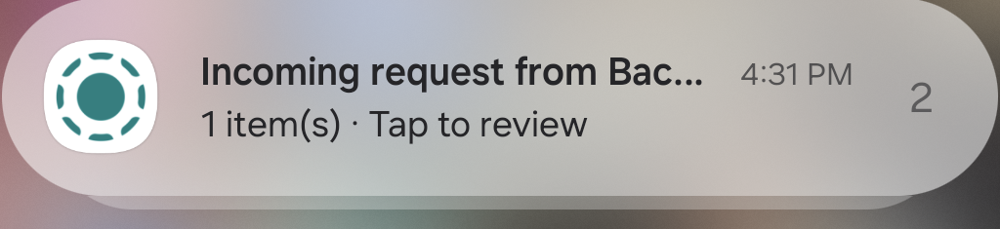
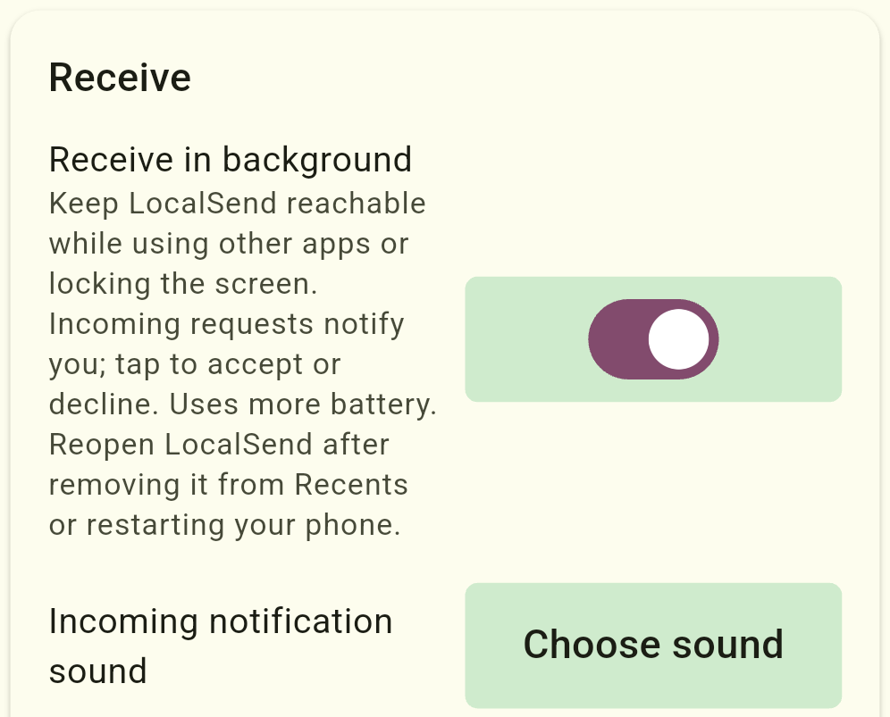
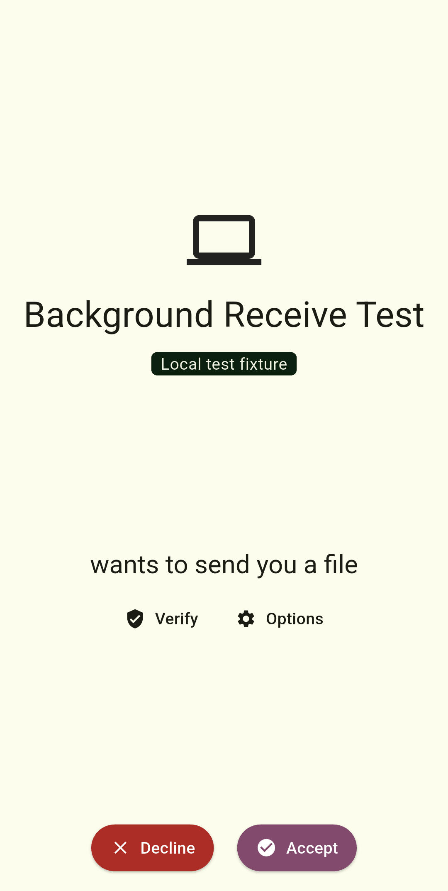
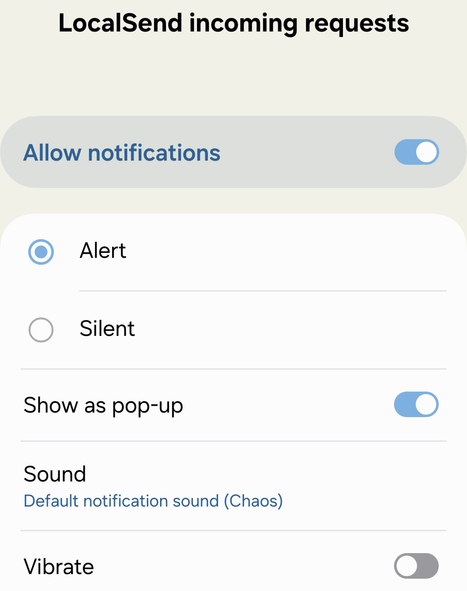

# LocalSend: Android background receiving experiment

An unofficial experimental fork of [LocalSend](https://github.com/localsend/localsend), maintained by [Tony Destin (@limmieo)](https://github.com/limmieo).

LocalSend and its contributors built the underlying app, protocol, and cross-platform foundation. This fork adds a small set of Android receiving controls. It is independent of the official project and is not an official LocalSend release.

## Why this exists

I wanted LocalSend to stay reachable while I used another app, alert me when someone wanted to send a file, and stop background receiving when I closed LocalSend. This experiment adds those controls without changing the existing accept/decline flow.

## Additions

- **Receive in background:** an optional Android setting, off by default, that keeps the receiver available while the app remains running in the background.
- **Incoming-request alerts:** a separate notification opens the existing request screen so you can accept or decline. Background availability does not automatically accept files; Quick Save remains a separate setting.
- **Notification sound selection:** Settings > Receive > Incoming notification sound > Choose sound opens Android's incoming-request notification settings. Use Sound to choose a tone, including custom tones already available to the phone's sound picker.
- **Stop when closed:** receiving stops when LocalSend is closed or force-stopped. Removing it from Recents is also configured to stop the background service. Reopen LocalSend to restore your saved preference. There is no boot-start or automatic receiver restart.

## Try it

### Screenshots

Real screenshots from the Android 16 test phone, cropped to the relevant interface. The sender shown is a local test fixture.

**Incoming request while LocalSend is in the background**

| Background receiving controls | Existing accept/decline screen | Incoming-request sound controls |
| --- | --- | --- |
|  |  |  |

### Build and run

This repository currently publishes source code, not a production-ready APK. The locally tested preview is an ARM64 debug build, installed as **LocalSend Debug** alongside the official app. Run only one LocalSend receiver on a device at a time because they use the same port.

Build from `app/` using the upstream pinned Flutter version (`.fvmrc`), Android SDK/NDK, and the Rust toolchain in `rust-toolchain.toml`. Follow the [upstream build instructions](README.upstream.md#building). On Windows, use a compatible Java 17 environment and make sure `FLUTTER_ROOT` points at that Flutter SDK so the native Rust library is packaged.

Once running, open Settings > Receive, enable Receive in background, and allow notifications. Press Home to switch apps. An incoming request should produce an alert; tap it to review before accepting.

## Test status and limitations

The app test suite passed **95 tests**, including seven new tests. Flutter analysis and the Android build passed. On one Galaxy S24 FE running Android 16, background alerts, notification-tap review, explicit acceptance, file-hash verification, decline, cancellation cleanup, the sound settings button, and force-stop shutdown were exercised.

Short screen-off transition testing was performed. Extended locked-screen idle/Doze, battery consumption, Wi-Fi reconnection, and other vendors are **not yet qualified**. The implementation holds wake and multicast locks, which can increase battery use. Removing from Recents is configured in source but has not yet been independently tested on the phone. iOS behavior is unchanged.

See [TESTING.md](TESTING.md) for evidence and remaining checks and [FORK_CHANGES.md](FORK_CHANGES.md) for the changed files and architecture.

## Credit and license

- **Original LocalSend:** Tien Do Nam and the [LocalSend contributors](https://github.com/localsend/localsend/graphs/contributors). Please support and credit the [official project](https://localsend.org).
- **Fork feature direction, requirements, and on-device testing:** Tony Destin (@limmieo).
- **Implementation and test assistance:** OpenAI Codex. These modifications were developed with AI assistance and are disclosed as such.

The original copyright and [Apache License 2.0](LICENSE) are retained. Fork modifications are provided under the same license. Modification notices identify the changed source files; original code and attribution remain intact. The original README is preserved in [README.upstream.md](README.upstream.md).

LocalSend's upstream contribution rules restrict AI-generated submissions. Publishing this independent fork does not imply upstream acceptance or endorsement. No pull request has been submitted to the official project.
